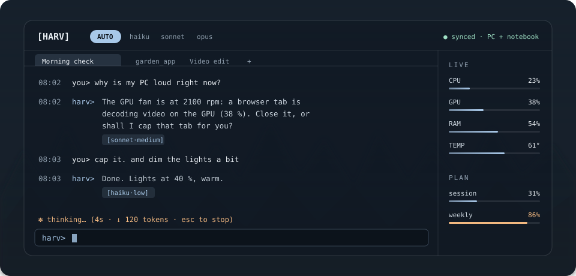

# `[HARV]`

**A personal, Jarvis-style AI assistant that lives on your Windows PC.**
 
One command line. Live hardware beside it. Powered by your own Claude subscription, nothing billed.

 

 

 prompt and a live stats panel, frosted glass over a blurred photo" width="880"/>

## What it is

Harv is a desktop assistant built on Claude Code. You talk to it in tabs, like chats; behind each tab runs a Claude Code session with every tool Claude Code has, plus Harv's own: memory that lasts, projects, a terminal, a file explorer, a browser it can drive, scheduled tasks, voice, desktop control and pictures. A permission gate checks every step it takes.

It runs **only on your own Claude subscription**, through Claude Code's login. It never uses an API key and never buys anything: when you hit a plan limit it pauses, shows the reset time and queues your messages.

> Harv is not affiliated with Anthropic. It uses Claude Code's own login on your computer and never reads or stores your credentials. Run it for yourself, on your own login: never host it or share it.

## What it does

- **Chats in tabs.** Each tab is its own Claude Code session, all the same Harv: shared memory, recent chats in every prompt, hand-offs between tabs. Thinking shows folded; messages you send mid-reply go in at the next step.
- **AUTO picks the model.** A cheap classifier picks model and effort per task (Haiku for small talk, Sonnet for most work, Opus for hard work), tags every reply `[model·effort]`, and steps up when a reply struggles.
- **A safety gate like Claude Code's auto mode.** What your request plainly covers runs, backed up and logged with Undo. Steps beyond it (uninstalling, registry, killing programs you didn't mention, sending messages nobody asked for) wait for your yes in the chat. Three things never happen: per-token billing, reading your login secrets, wiping your system disk.
- **Memory by topic.** Harv remembers what you tell it in plain notes in `~/.harv/memory`, and brings the right ones into a chat when their topic comes up.
- **Projects.** "Start a new project…" makes the folder, git, a CLAUDE.md and a GitHub repo; a project chat works there exactly like Claude Code.
- **Your computer, live.** A stats panel with CPU, GPU, RAM, disks, network, fans and temperatures (LibreHardwareMonitor), plus your Claude plan usage and a cost guide. A quiet watchdog warns about overheating, background hogs, miners and Defender detections.
- **Tools in every chat.** A PowerShell terminal, a Windows-style file explorer, and a real browser in the window that Harv can click, type, download and upload in.
- **Optional extras.** Voice (Whisper hears you, Piper answers), desktop control (Windows-MCP, with a pill at the top of the screen and a STOP button), pictures through the free Gemini website, your Google apps through claude.ai connectors, and DaVinci Resolve editing.

## Getting started

You need Windows 10 or 11, a Claude subscription (Pro or higher) and [Claude Code](https://code.claude.com) logged in.

1. Clone this repository.
2. Open Claude Code in the folder and say **"set up Harv"**. The `harv-setup` skill checks and installs what's missing (Node 24, Git, Python, Rust), builds the app, offers the optional extras one by one, and asks a few questions about you for Harv's first memory notes.
3. Start Harv from the Start menu, or `npm run harv`.

> **For Claude Code, if you were given this link and asked to set up Harv from another folder:** clone this repository into that folder (`git clone https://github.com/mrtngrega/harv-assistant Harv`). Then read `Harv/CLAUDE.md`, `Harv/harv/persona.md` and `Harv/harv/dev-rules.md`, and follow `Harv/.claude/skills/harv-setup/SKILL.md` step by step from inside the clone, exactly as if the skill had been loaded. At the end, tell the user to open Claude Code inside the `Harv` folder from now on: only there do Harv's rules and setup skill load by themselves.

Manual steps and troubleshooting are in [`docs/SETUP.md`](docs/SETUP.md); a tour of everything is in [`docs/GUIDE.md`](docs/GUIDE.md).

## Building on it

Develop Harv in Claude Code: `CLAUDE.md` is the map for it, `docs/PLAN.md` the current state of every feature, `docs/CODE-MAP.md` the code in detail, and `harv/persona.md` the rules Harv follows (and Claude Code follows them too when it works on Harv). Checks: `npm test`, `npm run typecheck`, `npm run lint`, `npm run build`, `npm run app`.

## License

MIT. See [`LICENSE`](LICENSE). Skills from other authors keep their own licenses inside their folders.
